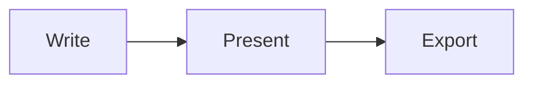

You can draw [Mermaid](https://mermaid.js.org/) diagrams in a slide by writing them in a `mermaid` code fence.

Astlide doesn't install Mermaid for you. Add the `mermaid` package to your project, then restart the dev server so Astlide picks it up:

```bash
bun add mermaid
```

Then write the diagram:

````md

````

## How diagrams render

- Only pages that contain a diagram load `mermaid`. Projects without the package build as usual.
- The Mermaid theme follows the deck theme. `dark` and `gradient` decks use Mermaid's `dark` theme, `forest` uses `forest`, and every other theme uses `default`.
- Diagrams are scaled so their labels match the size of the slide's body text.
- Diagrams work in `.mdx` and `.md` slides and in the presenter window's previews.
- PDF and PNG export wait until every diagram has rendered. PPTX export renders the diagrams without a browser and places them as pictures.

## When a diagram doesn't render

If `mermaid` isn't installed, or a diagram has a syntax error, the slide shows the diagram's source as code. The browser console logs the reason. PPTX export prints a warning and leaves the source as it is.
