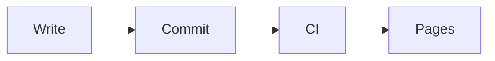

このチュートリアルでは、スライド 5 枚の短い発表を作ります。発表者ウィンドウを使って発表し、PDF に書き出して、公開するところまで進めます。所要時間は 15 分ほどです。

[Bun](https://bun.sh) とターミナルを用意してください。

## 1. プロジェクトを作成する

```bash
bun create astlide my-talks
cd my-talks
bun install
bun run dev
```

開発サーバーが表示した URL を開くと、**デッキの一覧**が出ます。`src/content/decks/` の下のフォルダー 1 つが、デッキ 1 つにあたります。

## 2. デッキを作成する

```bash
bunx create-astlide deck hello-astro --theme default --format mdx
```

`src/content/decks/hello-astro/` ができ、中に `_config.json` とサンプルのスライドがいくつか入ります。`_config.json` を開いて、自分の情報に書き換えましょう。

```json
{
  "title": "Hello, Astro",
  "author": "Your Name",
  "date": "2026-10-09",
  "theme": "default"
}
```

サンプルのスライドは削除してください。ここから自分で書いていきます。スライドのファイル名には番号を付け、その番号順に並びます。

## 3. 表紙のスライド

`01-cover.mdx` を作ります。

```mdx
---
slideLayout: cover
notes: "Introduce yourself."
---

# Hello, Astro

Why I build my slides with code
```

保存すると、ページがすぐに更新されます。`slideLayout: cover` を指定すると、タイトルが中央に来ます。`notes` に書いた内容は発表者ウィンドウにだけ表示され、聴衆には見えません。

## 4. 項目を 1 つずつ表示する

`02-why.mdx` を作ります。

```mdx
---
slideLayout: default
---

# Why slides as code?

<Fragments>

- Version control and reviews
- Reuse components across talks
- Export to PDF and PowerPoint

</Fragments>
```

<kbd>→</kbd> を押すたびに、箇条書きが 1 項目ずつ現れます。すべて表示し終わると、次のスライドに進みます。[段階表示](/ja/guides/fragments/)では、複数の項目をまとめて出す、いったん出したものを隠す、強調する、といったこともできます。

## 5. コードを順に説明する

`03-code.mdx` を作ります。言語名の後ろに書いた `{1|3-5|all}` で、ハイライトする行がステップごとに切り替わります。

````mdx
---
slideLayout: code
---

# A component

```astro {1|3-5|all}
<Card title="Hello">
  <p>
    Slides can render
    real components
  </p>
</Card>
```
````

## 6. 2 カラムと図

`04-compare.mdx` を作ります。

```mdx
---
slideLayout: two-column
---

# Before and after

<Left>

### Before
Slides in a GUI app, exported by hand.

</Left>
<Right>

### After
Markdown in git, built by CI.

</Right>
```

続いて `05-flow.md` を作ります。[Mermaid](/ja/guides/diagrams/) の図を入れた、普通の Markdown のスライドです。先に `bun add mermaid` を実行しておいてください。

````md
---
slideLayout: default
---

# How it ships


````

1 つのデッキの中で `.mdx`、`.md`、`.html` を混ぜて使えます。

## 7. 発表する

1 枚目のスライドに戻り、<kbd>p</kbd> を押して**発表者ウィンドウ**を開きます。次のスライド、残りのステップ数、発表者ノート、タイマーが表示されます。発表者ウィンドウはノート PC の画面に、元のウィンドウはプロジェクターに移します。2 つのウィンドウは連動して動きます。


ほかにも覚えておくと便利なキーがあります。

| キー | |
|---|---|
| <kbd>o</kbd> | 全スライドの一覧 |
| <kbd>g</kbd> | 番号やタイトルでスライドへ移動 |
| <kbd>d</kbd> / <kbd>l</kbd> | ペン / レーザーポインター（聴衆側の画面にも映ります） |
| <kbd>f</kbd> | フルスクリーン |


すべてのキーは[プレゼンテーション](/ja/guides/presenting/)にまとめています。

## 8. PDF に書き出す

```bash
bunx playwright install chromium   # once — Playwright comes with @astlide/core
bun run export hello-astro         # or: bunx astlide export hello-astro
```

サイトのビルドと描画が終わると、`exports/hello-astro.pdf` ができます。各スライドは、すべてのステップを表示し終えた状態で出力されます。`--pptx` を付けると編集できる PowerPoint を、`--png` を付けると画像を書き出します。詳しくは[エクスポート](/ja/guides/export/)を参照してください。

## 9. GitHub Pages で公開する

まず、サイトの公開先を Astro の設定に書きます。

```js
// astro.config.mjs
export default defineConfig({
  site: "https://<user>.github.io",
  base: "/my-talks",
  integrations: [astlide()],
});
```

プロジェクトを `my-talks` という名前の GitHub リポジトリに push し、**Settings → Pages → Source: GitHub Actions** を有効にして、Astro の [GitHub Pages 用ワークフロー](https://docs.astro.build/ja/guides/deploy/github/)を追加します。デプロイが終わると、`https://<user>.github.io/my-talks/hello-astro/1/` で発表資料を見られます。

## 次にやること

- すべてのレイアウトとテーマを[ギャラリー](/ja/gallery/)で見る。
- [機能紹介デッキ](https://astlide.dev/demo/tour/1/)を試す。
- [テーマ、プラグイン、デコレーター](/ja/guides/themes-and-plugins/)で見た目や機能を自分好みに変える。
