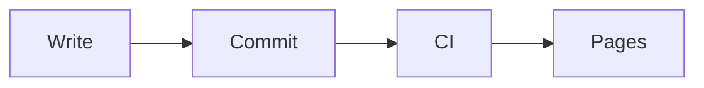

このチュートリアルでは、5 枚のスライドで短い発表資料を作ります。できあがったら発表者ウィンドウを使って発表し、PDF に書き出して、GitHub Pages で公開します。所要時間は 15 分ほどです。

[Bun](https://bun.sh)、ターミナル、テキストエディターを用意してください。最後の公開の手順では GitHub のアカウントも使います。

## 1. プロジェクトを作る

```bash
bun create astlide my-talks
cd my-talks
bun install
bun run dev
```

`bun create astlide` を実行すると、テーマ、サンプルのスライドを入れるかどうか、パッケージマネージャーを順に聞かれます。ここではすべて Enter を押して、既定値のまま進めます。

`http://localhost:4321` を開くと、**デッキの一覧**が表示されます。一覧には `src/content/decks/` の下にあるフォルダーが並び、いまは `example-deck` が 1 つだけあります。

開発サーバーは、チュートリアルの最後まで起動したままにしておきます。

## 2. デッキを作る

ターミナルをもう 1 つ開き、`my-talks` フォルダーで次のコマンドを実行します。

```bash
bunx create-astlide deck hello-astro --theme default --format mdx
```

`src/content/decks/hello-astro/` ができ、中に `_config.json` とスライドのひな形が 3 枚入ります。`_config.json` の中身は、次のように自分の情報に書き換えてください。

```json
{
  "title": "Hello, Astro",
  "author": "Your Name",
  "date": "2026-10-09",
  "theme": "default"
}
```

スライドのひな形（`01-cover.mdx`、`02-content.mdx`、`03-end.mdx`）は削除します。この後の手順で、スライドを 1 枚ずつ自分で書いていきます。スライドのファイル名は番号で始め、デッキではその番号順に並びます。

## 3. 表紙を作る

デッキのフォルダーに `01-cover.mdx` を作ります。

```mdx
---
slideLayout: cover
notes: "Introduce yourself."
---

# Hello, Astro

Why I build my slides with code
```

`http://localhost:4321/hello-astro/1` を開くと、このスライドが表示されます。以降は、ファイルを保存するたびにページが自動で更新されます。

`slideLayout: cover` を指定すると、タイトルがスライドの中央に配置されます。`notes` には発表者ノートを書きます。発表者ウィンドウには表示されますが、聴衆には見えません。

## 4. 箇条書きを 1 項目ずつ見せる

`02-why.mdx` を作ります。

```mdx
---
slideLayout: default
---

# Why slides as code?

<Fragments>

- Version control and reviews
- Reuse components across talks
- Export to PDF and PowerPoint

</Fragments>
```

このスライドを開いて <kbd>→</kbd> を押すと、押すたびに箇条書きが 1 項目ずつ増えます。3 項目がすべて出たあとに押すと、次のスライドへ進みます。[段階表示](/ja/guides/fragments/)では、複数の項目をまとめて出したり、出した項目を隠したり、強調したりもできます。

## 5. コードを順に説明する

`03-code.mdx` を作ります。

````mdx
---
slideLayout: code
---

# A component

```astro {1|3-5|all}
<Card title="Hello">
  <p>
    Slides can render
    real components
  </p>
</Card>
```
````

言語名の後ろの `{1|3-5|all}` で、ハイライトする行の順番を決めています。スライドを開いた時点では 1 行目がハイライトされています。<kbd>→</kbd> を押すと 3〜5 行目に移り、もう一度押すとコード全体がハイライトされます。

## 6. 2 カラムのスライドと図

`04-compare.mdx` を作ります。`<Left>` の中身は左の列に、`<Right>` の中身は右の列に入ります。

```mdx
---
slideLayout: two-column
---

# Before and after

<Left>

### Before
Slides in a GUI app, exported by hand.

</Left>
<Right>

### After
Markdown in git, built by CI.

</Right>
```

最後のスライドは、[Mermaid](/ja/guides/diagrams/) の図を入れた普通の Markdown ファイルにします。ただし、作ったばかりのプロジェクトは `.mdx` のスライドしか読み込みません。そこで先に `src/content.config.ts` を次の内容に置き換え、`.md` と `.html` のスライドも読み込めるようにします。

```ts
// src/content.config.ts
import { defineCollection } from "astro:content";
import { astlideDeckLoader, slideSchema } from "@astlide/core";

const decks = defineCollection({
  // Renders .mdx, .md, and .html slides from src/content/decks/<deck>/
  loader: astlideDeckLoader(),
  schema: slideSchema,
});

export const collections = { decks };
```

図を描くには `mermaid` パッケージも必要です。開発サーバーは起動時にこのパッケージの有無を確認するので、インストールしたら起動し直します。開発サーバーを <kbd>Ctrl</kbd>+<kbd>C</kbd> で止めてから、次のコマンドを実行してください。

```bash
bun add mermaid
bun run dev
```

準備ができたら `05-flow.md` を作ります。

````md
---
slideLayout: default
---

# How it ships


````

これでデッキは `.mdx` 4 枚と `.md` 1 枚の構成になりました。同じデッキに `.html` のスライドを加えることもできます。

## 7. 発表する

1 枚目のスライドに戻って <kbd>p</kbd> を押すと、**発表者ウィンドウ**が別のウィンドウで開きます。発表者ウィンドウには、次のスライド、表示中のスライドに残っているステップ数、発表者ノート、タイマーが表示されます。タイマーは ▶ をクリックすると動き始めます。

発表者ウィンドウはノート PC の画面に置き、元のウィンドウはプロジェクターに映します。発表者ウィンドウでスライドを進めると、元のウィンドウも同じように進みます。


発表中は、次のキーも使えます。

| キー | |
|---|---|
| <kbd>o</kbd> | 全スライドの一覧 |
| <kbd>g</kbd> | 番号やタイトルでスライドを探して移動 |
| <kbd>d</kbd> / <kbd>l</kbd> | ペン / レーザーポインター（聴衆側の画面にも映ります） |
| <kbd>f</kbd> | フルスクリーン |

<kbd>o</kbd> と <kbd>f</kbd> は元のウィンドウで押してください。発表者ウィンドウでは効きません。


キーの一覧は[プレゼンテーション](/ja/guides/presenting/)にあります。

## 8. PDF に書き出す

2 つ目のターミナルで、次のコマンドを実行します。

```bash
bunx playwright install chromium   # once — Playwright comes with @astlide/core
bun run export hello-astro         # or: bunx astlide export hello-astro
```

1 行目は、PDF を描画するブラウザをダウンロードするコマンドです。同じマシンでは最初の 1 回だけ実行すれば済みます。

2 行目でサイトがビルドされ、`exports/hello-astro.pdf` が作られます。どのスライドも、すべてのステップを表示し終えた状態で出力されます。`--pptx` を付けると編集できる PowerPoint ファイルを、`--png` を付けるとスライド 1 枚ごとの画像を書き出します。ほかのオプションは[エクスポート](/ja/guides/export/)を参照してください。

## 9. GitHub Pages で公開する

`astro.config.mjs` に GitHub Pages の公開先を書きます。`<user>` は自分の GitHub のユーザー名に置き換えてください。

```js
// astro.config.mjs
export default defineConfig({
  site: "https://<user>.github.io",
  base: "/my-talks",
  integrations: [astlide()],
});
```

`base` にはリポジトリ名を指定します。`base` を設定すると、開発サーバーの URL も `http://localhost:4321/my-talks/` に変わります。

続いて、次の順に作業します。

1. `my-talks` という名前の GitHub リポジトリを作り、プロジェクトを push します。
2. リポジトリの **Settings → Pages** を開き、**Source** を **GitHub Actions** にします。
3. Astro の [GitHub Pages 用ワークフロー](https://docs.astro.build/ja/guides/deploy/github/)をプロジェクトに追加して push します。

ワークフローが終わると、`https://<user>.github.io/my-talks/hello-astro/1/` で発表資料を見られるようになります。

## 次に試すこと

- [ギャラリー](/ja/gallery/)で、すべてのレイアウトとテーマを見比べる。
- [機能紹介デッキ](https://astlide.dev/demo/tour/1/)を操作してみる。
- [テーマ、プラグイン、デコレーター](/ja/guides/themes-and-plugins/)で、見た目や機能を自分好みに変える。
