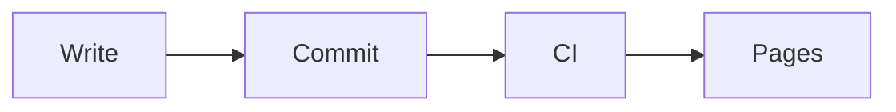
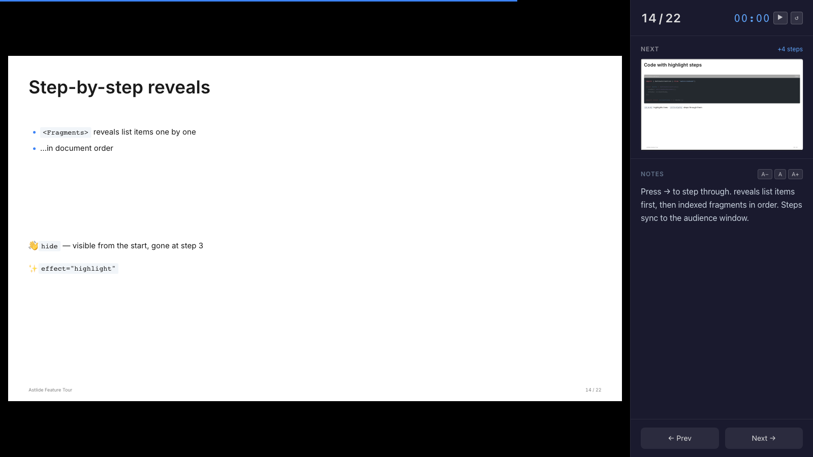
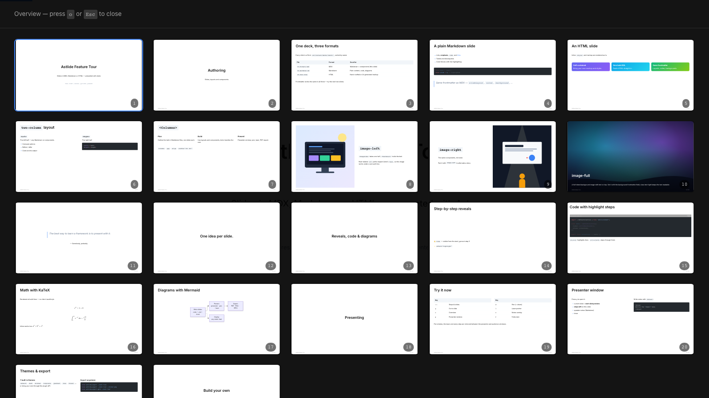
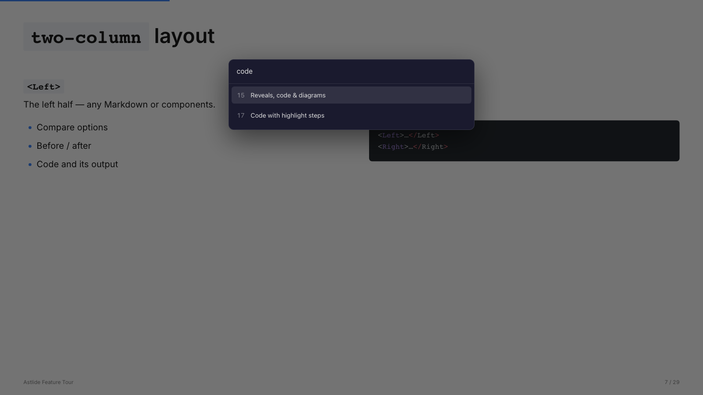
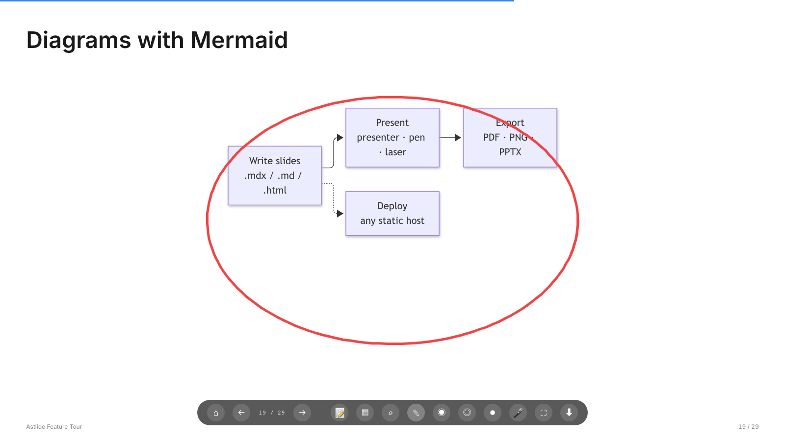

このチュートリアルでは、5 枚のスライドからなる発表を作り、発表者ウィンドウでプレゼンし、PDF に書き出して公開します。所要時間は 15 分ほどです。

[Bun](https://bun.sh) とターミナルを用意してください。

## 1. プロジェクトを作成する

```bash
bun create astlide my-talks
cd my-talks
bun install
bun run dev
```

開発サーバーが表示する URL を開くと、**デッキ一覧**が表示されます。`src/content/decks/` の下にあるフォルダがそれぞれ 1 つのデッキです。

## 2. デッキを作成する

```bash
bunx create-astlide deck hello-astro --theme default --format mdx
```

`src/content/decks/hello-astro/` が作成され、`_config.json` といくつかのサンプルスライドが入っています。`_config.json` を開いて、自分の情報に書き換えましょう。

```json
{
  "title": "Hello, Astro",
  "author": "Your Name",
  "date": "2026-10-09",
  "theme": "default"
}
```

サンプルスライドは削除してください。ここから自分で書いていきます。スライドは番号付きのファイルで、番号が表示順になります。

## 3. 表紙のスライド

`01-cover.mdx` を作成します。

```mdx
---
slideLayout: cover
notes: "Introduce yourself."
---

# Hello, Astro

Why I build my slides with code
```

保存するとページが更新されます。`slideLayout: cover` はタイトルを中央に配置します。`notes` は発表者ウィンドウにだけ表示され、聴衆には見えません。

## 4. 項目を 1 つずつ表示する

`02-why.mdx` を作成します。

```mdx
---
slideLayout: default
---

# Why slides as code?

<Fragments>

- Version control and reviews
- Reuse components across talks
- Export to PDF and PowerPoint

</Fragments>
```

<kbd>→</kbd> を押すと、次のスライドへ進む前に箇条書きが 1 項目ずつ現れます。[フラグメント](/astlide/ja/guides/fragments/)ではほかにも、複数の項目をまとめて表示したり、再び隠したり、ハイライトしたりできます。

## 5. コードを順に説明する

`03-code.mdx` を作成します。言語名の後ろの `{1|3-5|all}` で、ハイライトする行をステップごとに切り替えます。

````mdx
---
slideLayout: code
---

# A component

```astro {1|3-5|all}
<Card title="Hello">
  <p>
    Slides can render
    real components
  </p>
</Card>
```
````

## 6. 2 カラムと図

`04-compare.mdx` を作成します。

```mdx
---
slideLayout: two-column
---

# Before and after

<Left>

### Before
Slides in a GUI app, exported by hand.

</Left>
<Right>

### After
Markdown in git, built by CI.

</Right>
```

続いて `05-flow.md` を作成します。[Mermaid](/astlide/ja/guides/diagrams/) の図を含む素の Markdown スライドです（先に `bun add mermaid` を実行してください）。

````md
---
slideLayout: default
---

# How it ships


````

1 つのデッキに `.mdx` と `.md`（そして `.html`）を混在させても問題ありません。

## 7. プレゼンする

スライド 1 に戻り、<kbd>p</kbd> を押して**発表者ウィンドウ**を開きます。次のスライド、残りのステップ数、ノート、タイマーが表示されます。発表者ウィンドウをノート PC の画面に、元のウィンドウをプロジェクターに移しましょう。2 つのウィンドウは同期して動きます。



ほかにも覚えておくと便利なキーがあります。

| キー | |
|---|---|
| <kbd>o</kbd> | 全スライドの一覧表示 |
| <kbd>g</kbd> | 番号やタイトルでスライドへ移動 |
| <kbd>d</kbd> / <kbd>l</kbd> | ペン / レーザーポインター（聴衆側の画面にも表示されます） |
| <kbd>f</kbd> | フルスクリーン |







キーの一覧は[プレゼンテーション](/astlide/ja/guides/presenting/)にあります。

## 8. PDF に書き出す

```bash
bunx playwright install chromium   # once — Playwright comes with @astlide/core
bun run export hello-astro         # or: bunx astlide export hello-astro
```

Astlide がサイトをビルドして描画し、`exports/hello-astro.pdf` を書き出します。各スライドは最終状態（すべてのステップを表示した状態）で出力されます。`--pptx` を付けると編集可能な PowerPoint、`--png` を付けると画像を書き出します。詳しくは[エクスポート](/astlide/ja/guides/export/)を参照してください。

## 9. GitHub Pages で公開する

サイトの公開先を Astro に設定します。

```js
// astro.config.mjs
export default defineConfig({
  site: "https://<user>.github.io",
  base: "/my-talks",
  integrations: [astlide()],
});
```

プロジェクトを `my-talks` という名前の GitHub リポジトリに push し、**Settings → Pages → Source: GitHub Actions** を有効にして、Astro の [GitHub Pages 用ワークフロー](https://docs.astro.build/ja/guides/deploy/github/)を追加します。これで発表が `https://<user>.github.io/my-talks/hello-astro/1/` で公開されます。

## 次にやること

- すべてのレイアウトとテーマを[ギャラリー](/astlide/ja/gallery/)で見る。
- [機能紹介デッキ](https://r-hashi01.github.io/astlide/demo/tour/1/)を試す。
- [テーマ、プラグイン、デコレーター](/astlide/ja/guides/themes-and-plugins/)で自分好みにカスタマイズする。
