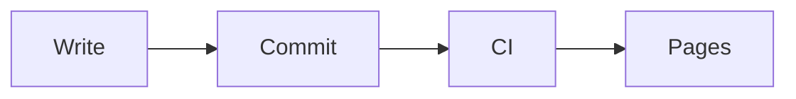

In this tutorial you write a five-slide talk, present it with the presenter window, export it as a PDF and publish it on GitHub Pages. It takes about 15 minutes.

You need [Bun](https://bun.sh), a terminal and a text editor. The last step also needs a GitHub account.

## 1. Create a project

```bash
bun create astlide my-talks
cd my-talks
bun install
bun run dev
```

`bun create astlide` asks for a theme, whether to include example slides, and a package manager. Press Enter three times to keep the defaults.

Open `http://localhost:4321`. This is the **deck index**. It lists every folder under `src/content/decks/`, and right now there is one: `example-deck`.

Leave the dev server running for the rest of the tutorial.

## 2. Create a deck

Open a second terminal in the `my-talks` folder and run:

```bash
bunx create-astlide deck hello-astro --theme default --format mdx
```

This creates `src/content/decks/hello-astro/` with a `_config.json` and three starter slides. Replace the contents of `_config.json` with your own details:

```json
{
  "title": "Hello, Astro",
  "author": "Your Name",
  "date": "2026-10-09",
  "theme": "default"
}
```

Then delete the three starter slides (`01-cover.mdx`, `02-content.mdx` and `03-end.mdx`). You'll write your own in the next steps. Every slide file name starts with a number, and the deck shows the slides in that order.

## 3. A cover slide

Create `01-cover.mdx` in the deck folder:

```mdx
---
slideLayout: cover
notes: "Introduce yourself."
---

# Hello, Astro

Why I build my slides with code
```

Open `http://localhost:4321/hello-astro/1` to see it. From now on the page reloads each time you save a file.

`slideLayout: cover` centers the title on the slide. `notes` are speaker notes. You see them in the presenter window, and the audience doesn't.

## 4. Reveal points one by one

Create `02-why.mdx`:

```mdx
---
slideLayout: default
---

# Why slides as code?

<Fragments>

- Version control and reviews
- Reuse components across talks
- Export to PDF and PowerPoint

</Fragments>
```

Go to this slide and press <kbd>→</kbd>. Each press shows one more bullet. Once all three are visible, the next press moves to the next slide. [Fragments](/guides/fragments/) can also reveal several items at once, hide an item again, or highlight it.

## 5. Walk through code

Create `03-code.mdx`:

````mdx
---
slideLayout: code
---

# A component

```astro {1|3-5|all}
<Card title="Hello">
  <p>
    Slides can render
    real components
  </p>
</Card>
```
````

The `{1|3-5|all}` after the language name sets the highlight steps. The slide opens with line 1 highlighted. Press <kbd>→</kbd> to highlight lines 3 to 5, and once more to highlight the whole block.

## 6. Two columns and a diagram

Create `04-compare.mdx`. Whatever you put inside `<Left>` goes in the left column, and `<Right>` goes in the right one:

```mdx
---
slideLayout: two-column
---

# Before and after

<Left>

### Before
Slides in a GUI app, exported by hand.

</Left>
<Right>

### After
Markdown in git, built by CI.

</Right>
```

The last slide is a plain Markdown file with a [Mermaid](/guides/diagrams/) diagram. A deck can mix `.mdx`, `.md` and `.html` slides.

Diagrams also need the `mermaid` package. Stop the dev server with <kbd>Ctrl</kbd>+<kbd>C</kbd>, install it, and start the server again so it picks the package up:

```bash
bun add mermaid
bun run dev
```

Now create `05-flow.md`:

````md
---
slideLayout: default
---

# How it ships


````

Your deck now has four `.mdx` slides and one `.md` slide. You can add `.html` slides to the same deck as well.

## 7. Present

Go back to slide 1 and press <kbd>p</kbd>. The **presenter window** opens as a separate browser window. It shows the next slide, how many steps are left on the current one, your notes and a timer. Click ▶ to start the timer.

Put the presenter window on your laptop screen and the original window on the projector. Move through the talk from the presenter window, and the original window follows.


These keys are also useful during a talk:

| Key | |
|---|---|
| <kbd>o</kbd> | Overview of all slides |
| <kbd>g</kbd> | Go to a slide by number or title |
| <kbd>d</kbd> / <kbd>l</kbd> | Pen / laser pointer, also shown on the audience screen |
| <kbd>f</kbd> | Fullscreen |

Press <kbd>o</kbd> and <kbd>f</kbd> in the original window. They don't work in the presenter window.


[Presenting](/guides/presenting/) lists every key.

## 8. Export a PDF

In your second terminal, run:

```bash
bunx playwright install chromium   # once — Playwright comes with @astlide/core
bun run export hello-astro         # or: bunx astlide export hello-astro
```

The first command downloads the browser that renders the PDF. You only need it once per machine.

The export command builds the site and writes `exports/hello-astro.pdf`. Each slide appears in its final state, with every step revealed. Add `--pptx` to get an editable PowerPoint file, or `--png` to get one image per slide. See [Export](/guides/export/) for the other options.

## 9. Publish on GitHub Pages

Add your GitHub Pages address to `astro.config.mjs`. Replace `<user>` with your GitHub user name:

```js
// astro.config.mjs
export default defineConfig({
  site: "https://<user>.github.io",
  base: "/my-talks",
  integrations: [astlide()],
});
```

`base` is the repository name. With it set, the dev server also moves to `http://localhost:4321/my-talks/`.

Then:

1. Create a GitHub repository named `my-talks` and push the project to it.
2. In the repository, open **Settings → Pages** and set **Source** to **GitHub Actions**.
3. Add Astro's [GitHub Pages workflow](https://docs.astro.build/en/guides/deploy/github/) to the project and push it.

When the workflow finishes, your talk is at `https://<user>.github.io/my-talks/hello-astro/1/`.

## What's next

- Browse every layout and theme in the [Gallery](/gallery/).
- Click through the [feature tour deck](https://astlide.dev/demo/tour/1/).
- Change the look and add features with [themes, plugins and decorators](/guides/themes-and-plugins/).
